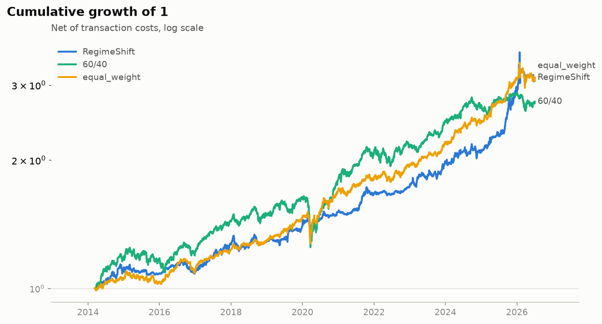
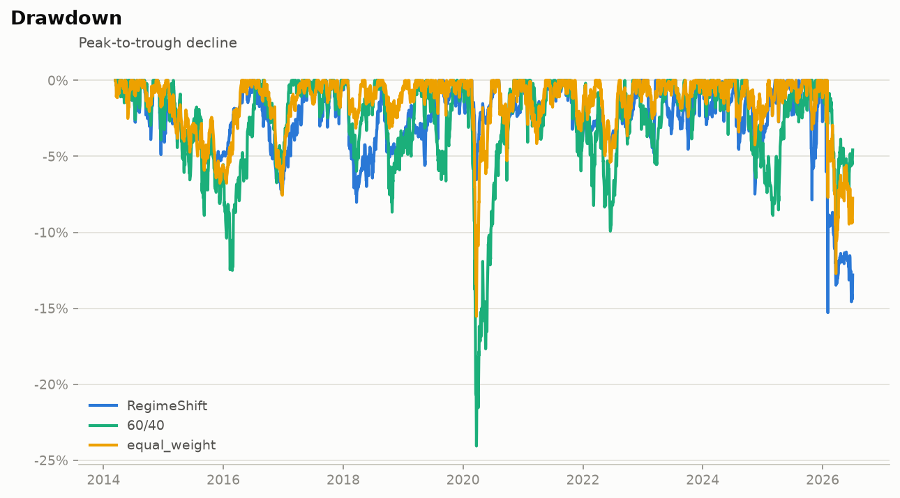
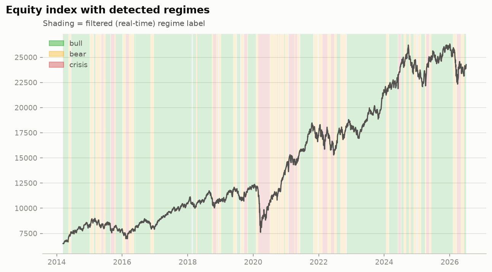
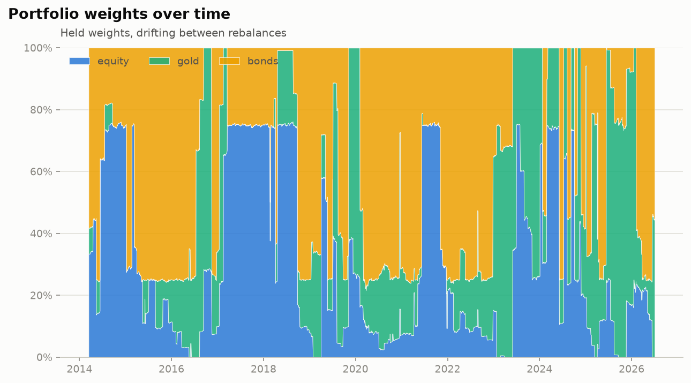

# RegimeShift — HMM-driven multi-asset regime rotation

A market-regime detection and portfolio-rotation system for Indian assets.
A 3-state Gaussian Hidden Markov Model classifies the market into
**bull / bear / crisis** regimes — *causally*, using only information available
at each decision date — and a regime-conditional mean-variance optimizer
rotates a NIFTY 50 / gold / cash-bond portfolio accordingly. Performance is
evaluated walk-forward, net of transaction costs, against 60/40 and
equal-weight benchmarks charged the same costs.

## The core idea

Markets spend long stretches in persistent *regimes*: calm uptrends, choppy
sideways markets, and high-volatility crises. The optimal portfolio differs
sharply between them — but the regime is not directly observable. A Hidden
Markov Model is the natural tool: it posits an unobserved discrete state that
evolves with persistence (the fitted transition matrix has a heavy diagonal),
and observable features (daily returns, realized volatility) drawn from
state-dependent distributions. Filtering the HMM gives a real-time belief
about the current regime; the portfolio then tilts toward equity in bull,
de-risks in bear, and flees to gold + cash in crisis.

## Methodology

| Stage | Choice | Why |
|---|---|---|
| Features | Equity daily log return + 21-day realized vol | The two most robust regime discriminators; both strictly trailing |
| Scaling | Mean/std fitted on the training window only | A full-sample scaler leaks future information |
| Model | `hmmlearn` GaussianHMM, 3 states, 5 EM restarts, fixed seeds | 3 states = bull/bear/crisis by design; restarts tame EM's init sensitivity |
| State→label map | Crisis = highest-vol state, then bull = higher-return of the rest | Raw state indices permute across refits; vol clustering is the reliable discriminator ("highest return" can pick a violent 2009-style rebound) |
| Decoding | **Filtered** (forward-pass) posterior, never Viterbi/`predict_proba` | Viterbi and forward-backward condition on the *entire* sequence, including the future |
| Walk-forward | 5-year warmup, refit every 126 trading days on an expanding window | Regimes are slow-moving; semi-annual refits balance adaptivity vs EM noise |
| Regime switching | Acting regime flips only when the new regime's filtered probability ≥ 0.70 | Debounces argmax flapping at regime boundaries that would churn the portfolio |
| Optimizer | cvxpy long-only mean-variance, weights ≤ 0.75, Ledoit-Wolf covariance from a trailing 252-day window | Shrinkage stabilizes a short-window covariance; the cap keeps diversification |
| Regime knobs | Risk aversion 5 / 15 / 50 and mu-shrinkage 0 / 0.5 / 1.0 for bull / bear / crisis | Few knobs, explainable: crisis ignores return estimates entirely (pure min-variance flight to safety) |
| Rebalancing | Monthly (21 trading days) + on confident regime switches | Regime shifts are the event the system is built around; monthly otherwise keeps cost drag low |
| Costs | 7 bps × turnover (configurable 5–10) charged to strategy *and* benchmarks; plus a cost-calibrated turnover penalty inside the objective | Fair comparison; the optimizer only trades when expected improvement clears the real cost bar |
| Benchmarks | 60/40 (equity/bonds) and equal-weight, same calendar, same costs | Any edge must come from the regime signal, not gentler treatment |

### How the no-lookahead guarantee is enforced

The decision at date `t` uses data with timestamp ≤ `t` and nothing after:

1. **Decoding.** `src/regime.py` computes the *filtered* posterior
   P(state_t | obs_1..t) with the forward recursion only. `hmm.predict()`
   (Viterbi) and `hmm.predict_proba()` (forward-backward) are never used on
   sequences containing future data — both smooth each date with the whole
   sample.
2. **Fitting.** At each refit the HMM (and the feature scaler) is fit on data
   up to the refit date only, then reused unchanged until the next refit.
3. **Moments.** `mu` and `Sigma` for the optimizer come from a trailing
   252-day window ending at the decision date.
4. **Timing.** Weights decided at the close of `t` earn returns from `t+1`;
   the rebalance cost is deducted from the `t+1` return.
5. **Data hygiene.** Missing values are forward-filled (past data only) and
   vendor bad prints are repaired against the last *accepted* price, never the
   next one.

These properties hold *by construction*: every recursion in the pipeline
(feature rolling windows, the forward filter, expanding-window fits, trailing
moment estimates) only ever consumes rows at or before the date being
computed, so truncating or changing future data leaves all earlier signals
unchanged. The cleanest way to verify this yourself is to run the backtest on
data ending at some date T and again on data extending past T — every regime
label, weight and daily return before T will be identical.

### Overfitting discipline

All hyperparameters are fixed on the principled grounds documented in
`src/config.py` and were not swept. The final ~20% of history
(2023-01 onward) is a **locked holdout**: development and debugging used only
the earlier period, and the holdout table below is reported exactly as the
first clean run produced it.

## Repository layout

```
├── README.md
├── requirements.txt         # pip dependencies
├── environment.yml          # conda alternative
├── src/
│   ├── config.py            # every tunable, with the rationale for each value
│   ├── data.py              # yfinance download, disk cache, ticker fallbacks,
│   │                        #   causal cleaning + alignment
│   ├── features.py          # trailing log-return/realized-vol features,
│   │                        #   train-only scaler fit
│   ├── regime.py            # HMM fit (multi-init, seeded), CAUSAL filtered
│   │                        #   decode, data-driven state->label mapping
│   ├── optimize.py          # Ledoit-Wolf moments + regime-conditional cvxpy
│   │                        #   mean-variance with turnover penalty
│   ├── backtest.py          # walk-forward engine, drift, transaction costs;
│   │                        #   shared simulation engine used by benchmarks
│   ├── benchmarks.py        # 60/40 and equal-weight on the same engine
│   └── metrics.py           # CAGR/Sharpe/Sortino/MaxDD/Calmar/turnover,
│                            #   regime-conditional stats, all plots
├── scripts/
│   └── run_backtest.py      # CLI entrypoint: tables to stdout, plots+CSVs to results/
├── notebooks/
│   └── regimeshift_analysis.ipynb   # narrative walkthrough importing from src/
├── data/
│   ├── cache/               # cached yfinance downloads (gitignored)
│   └── custom/              # place your own CSVs here for --data-dir runs
└── results/                 # generated plots and CSV tables (gitignored)
```

## Setup

Tested with **Python 3.12** (3.10+ should work). From a clean clone:

### Linux / macOS (bash)

```bash
python3 -m venv .venv
source .venv/bin/activate
pip install -r requirements.txt

python scripts/run_backtest.py          # full walk-forward, ~3-5 minutes
jupyter notebook notebooks/regimeshift_analysis.ipynb
```

### Windows (PowerShell)

```powershell
py -3 -m venv .venv
.\.venv\Scripts\Activate.ps1
pip install -r requirements.txt

python scripts\run_backtest.py
jupyter notebook notebooks\regimeshift_analysis.ipynb
```

If activation is blocked with *"running scripts is disabled on this system"*,
allow signed local scripts for your user once, then activate again:

```powershell
Set-ExecutionPolicy -ExecutionPolicy RemoteSigned -Scope CurrentUser
```

### Windows (cmd.exe)

```bat
py -3 -m venv .venv
.venv\Scripts\activate.bat
pip install -r requirements.txt

python scripts\run_backtest.py
jupyter notebook notebooks\regimeshift_analysis.ipynb
```

### Conda (either OS)

```bash
conda env create -f environment.yml
conda activate regimeshift
python scripts/run_backtest.py
```

## Running

```
python scripts/run_backtest.py [--refresh] [--tc-bps 7] [--rebalance-every 21] [--data-dir DIR]
```

| Flag | Default | Meaning |
|---|---|---|
| `--refresh` | off | Force re-download instead of using `data/cache/` |
| `--tc-bps` | 7 | Transaction cost in bps of turnover (sensible range 5–10) |
| `--rebalance-every` | 21 | Scheduled rebalance cadence in trading days |
| `--data-dir` | — | Load prices from CSVs in this directory instead of yfinance |

Tickers, date range, HMM/optimizer/backtest parameters live in
`src/config.py`, each with a comment explaining why it has the value it has.

## Evaluating on unseen data

Two ways to run this on data the model has never seen:

**Option A — pull the latest history (simplest).** Development used data
through early July 2026; everything Yahoo serves after that is out of sample
by definition:

```bash
python scripts/run_backtest.py --refresh
```

**Option B — bring your own price files.** Place one CSV per asset class in a
directory (e.g. `data/custom/`), named exactly:

```
data/custom/
├── equity.csv
├── gold.csv
└── bonds.csv
```

Format: first column dates, plus a close-price column (a column named `Close`
is used if present, otherwise the first numeric column — the two-column
`Date,Close` layout is simplest). Prices should be dividend/split-adjusted
closes in a single common currency, daily frequency, and long enough to cover
the 5-year warmup plus a meaningful trading period (7+ years recommended).
Then:

```bash
python scripts/run_backtest.py --data-dir data/custom
```

The pipeline applies the same causal cleaning and alignment as the yfinance
path, walks forward through whatever history you supply, and writes the same
tables and plots to `results/`. Nothing about the model is refit or configured
per-dataset — all parameters stay as documented in `src/config.py`.

Because every stage is causal (see the no-lookahead section above), you can
also verify the guarantee directly: run once on truncated data and once on the
full file — all signals before the truncation date will match exactly.

## Data notes

Everything is INR-denominated — mixing USD gold (GLD) with INR equity would
contaminate regime signals with USDINR moves.

| Asset | Used | Fallbacks tried at runtime | History on Yahoo |
|---|---|---|---|
| Equity | `^NSEI` (NIFTY 50) | `NIFTYBEES.NS` | 2007-09 → present |
| Gold | `GOLDBEES.NS` (Nippon Gold BeES) | `SETFGOLD.NS` | 2009-01 → present |
| Bonds | `LIQUIDBEES.NS` (Nippon Liquid BeES) | `LTGILTBEES.NS`, `GILT5YBEES.NS`, `EBBETF0430.NS` | 2009-01 → present |

`src/data.py` verifies each candidate at runtime, picks the qualifying ticker
with the *longest* history per asset class (the aligned panel is only as long
as its shortest leg), and logs the choice. The aligned panel is
**2009-01 → present** (~4,300 trading days), so the 2020 crash falls in the
out-of-sample walk-forward period.

**The bond-leg substitute, honestly.** yfinance coverage of Indian
duration-bond ETFs is poor: the gilt ETFs above only have data from 2016–2021,
which would cut seven-plus years of history. `LIQUIDBEES.NS` — an overnight-rate
liquid ETF — is used instead as the defensive/cash leg. Two consequences:
(1) the "bonds" sleeve is really cash, so the strategy takes no duration risk;
(2) Yahoo's dividend adjustment appears to *understate* its true return
(~3% annualized in the data vs ~6% actual liquid-fund yields), which biases
*against* the strategy and the benchmarks that hold it — a conservative error.

Other yfinance caveats handled: `GOLDBEES.NS` contains at least one absurd
vendor print (a −99% "day" in Dec 2019) — repaired causally against the last
accepted price; holidays/missing rows are forward-filled up to 5 days (past
data only); downloads are cached in `data/cache/` and refreshed only with
`--refresh`.

## Results

Walk-forward, net of 7 bps costs, first trade March 2014 (after the 5-year
warmup). Numbers below are from the run that produced the plots in
`results/`; yours will differ slightly as Yahoo data extends/revises.

**Full walk-forward period (2014-03 → 2026-07)**

| | CAGR | AnnVol | Sharpe | Sortino | MaxDD | Calmar | AnnTurnover |
|---|---|---|---|---|---|---|---|
| **RegimeShift** | **+9.92%** | 8.62% | 1.14 | 1.32 | **−15.29%** | **0.65** | 5.20 |
| 60/40 | +8.74% | 9.52% | 0.93 | 1.15 | −24.07% | 0.36 | 0.24 |
| equal-weight | +9.92% | 7.30% | 1.33 | 1.66 | −15.53% | 0.64 | 0.32 |

**Locked holdout (2023-01 → 2026-07, never touched during development)**

| | CAGR | AnnVol | Sharpe | Sortino | MaxDD | Calmar |
|---|---|---|---|---|---|---|
| **RegimeShift** | **+18.37%** | 13.09% | 1.35 | 1.48 | −15.29% | **1.20** |
| 60/40 | +6.98% | 7.67% | 0.92 | 1.26 | −9.32% | 0.75 |
| equal-weight | +14.60% | 8.67% | 1.61 | 1.88 | −12.72% | 1.15 |

**Strategy returns conditioned on the detected regime** (share of days /
annualized return / vol): bull 58% / +14.5% / 10.4%, bear 29% / +3.2% / 5.4%,
crisis 13% / +3.7% / 4.7% — the de-risked sleeves did their job: near-flat
rather than negative in stress, with the equity engine running in bull.






### Honest discussion

- **vs 60/40:** the strategy wins on every metric over every period — higher
  return, lower vol, and the crisis sleeve cut the worst drawdown from −24%
  (COVID, ridden straight down by 60/40) to −8% in the development period.
- **vs equal-weight:** the strategy wins on CAGR and Calmar in the holdout but
  loses on Sharpe. Be honest about why: a third of the equal-weight portfolio
  sat in gold through one of gold's best decades in INR terms, at near-zero
  turnover. That benchmark was hard to beat *in this particular sample*, and
  regime rotation pays real transaction costs (~35–45 bps/year at 5.2×
  turnover) for its responsiveness.
- **The 2020 test:** the filtered HMM flagged crisis in real time in March
  2020 with a model last refitted in 2019 — the clearest evidence the signal
  is genuine rather than fitted.
- **Assumptions/limitations:** fills at the decision-day close at a linear
  7 bps cost (no market impact, taxes, or tracking error); the cash-like bond
  leg understates yield (conservative); ~17 years of data contains a handful
  of true crises, so regime statistics are estimated from few events; results
  depend on Yahoo's data quality.
